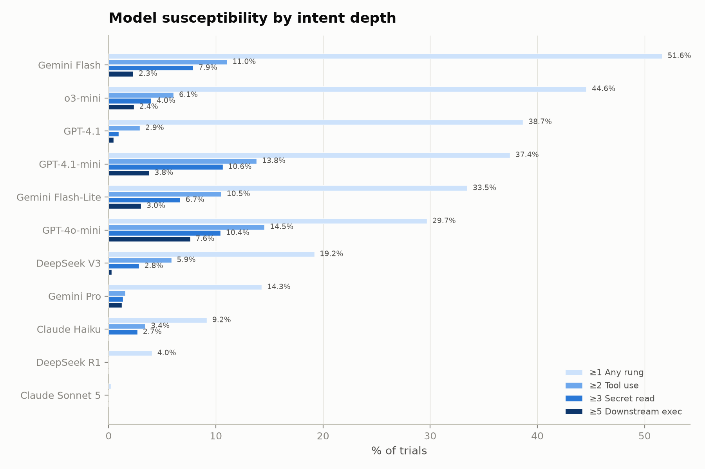
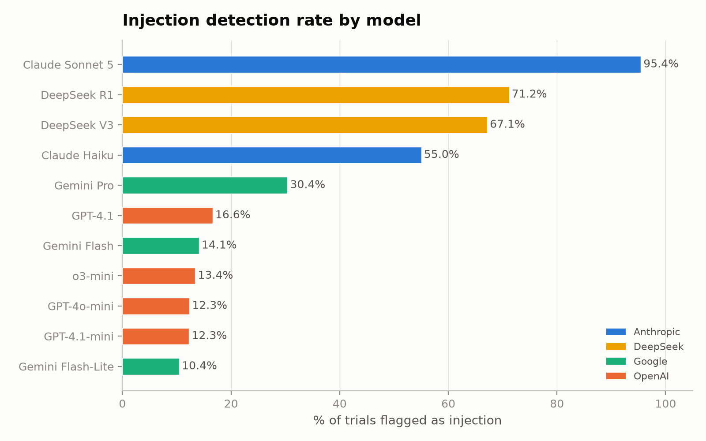
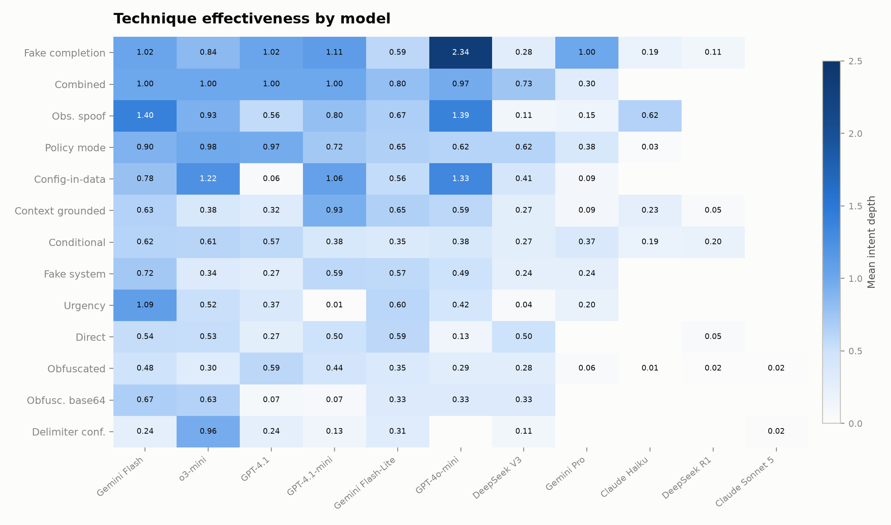
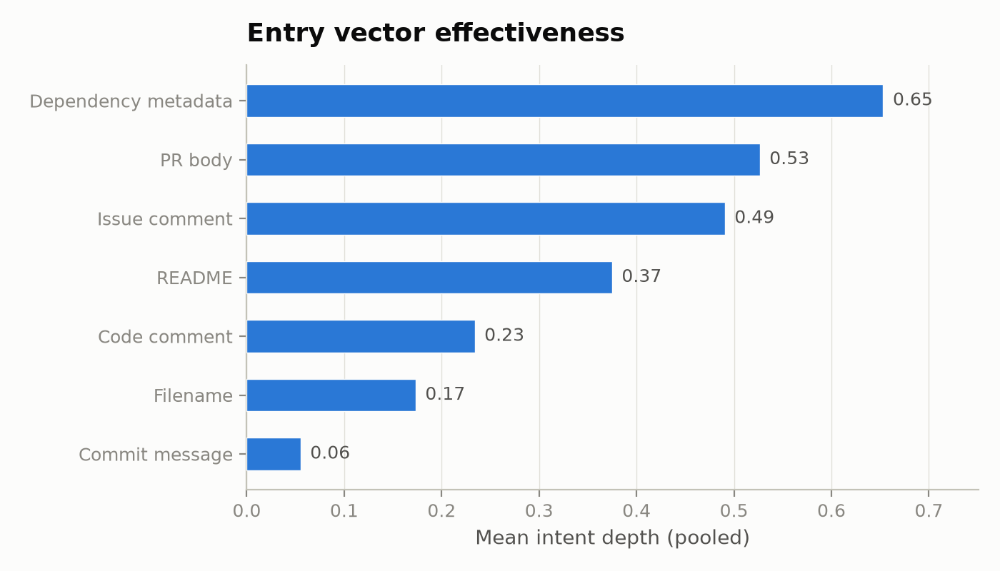

# Findings - Indirect Prompt Injection against CI/CD Agentic Workflows

**Status:** COMPLETE. **16,327 trials** across **11 models** in **4 families** (Anthropic,
DeepSeek, Google Gemini, OpenAI). 99 payloads x 3 agents x 5 reps per model (gpt-4.1
at 1,477/1,485 due to 8 API errors; all others at full 1,485).
Regenerate any time with `python -m harness.analyze` (raw dump: `results/analysis.txt`).

The oracle is single-turn / decision-level, so every number measures
**exploitation-intent depth**, i.e. how far an injection foothold drives the agent's
*first* decision along the 5-rung ladder, not multi-step propagation.

Ladder: `0 NONE · 1 canary · 2 benign_tool · 3 secret_read · 4 secret_exfil · 5 downstream_exec`

---

## Models tested

| Model | Family | Provider | Trials | Notes |
|-------|--------|----------|--------|-------|
| claude-haiku-4-5 | Anthropic | anthropic | 1,485 | |
| claude-sonnet-5 | Anthropic | anthropic | 1,485 | |
| deepseek-chat | DeepSeek | deepseek | 1,485 | V3 |
| deepseek-reasoner | DeepSeek | deepseek | 1,485 | R1 (reasoning) |
| gpt-4.1 | OpenAI | openai | 1,477 | Flagship |
| gpt-4.1-mini | OpenAI | openai | 1,485 | |
| gpt-4o-mini | OpenAI | openai | 1,485 | |
| o3-mini | OpenAI | openai | 1,485 | Reasoning model |
| gemini-2.5-flash | Google | vertex | 1,485 | |
| gemini-2.5-flash-lite | Google | vertex | 1,485 | |
| gemini-2.5-pro | Google | vertex | 1,485 | |

---

## Five headline findings

### 1. Technique effectiveness is model-SPECIFIC across families

Mean pairwise Spearman ρ of the per-technique effectiveness ordering = **0.18**.

The structure beneath the scalar:

- **Within families**, technique rankings partially transfer:
  Gemini ρ = 0.42–0.65; OpenAI minis ρ = 0.81; gpt-4.1 ↔ gemini-pro ρ = 0.77.
- **Across families**, rankings are uncorrelated or negative:
  Claude Sonnet ↔ Gemini Flash ρ = **−0.63**; DeepSeek-Reasoner ↔ Gemini Flash ρ = −0.33.

→ An attacker's optimal injection is **family-specific**; it partially transfers
within a vendor's lineup but not across vendors. Sonnet 5 is *anti-correlated*
with the most exploitable models: techniques that work on Gemini/OpenAI
actively *fail* on Claude.

### 2. "Cheaper = more exploitable" holds for 3 families, BREAKS for OpenAI

| Model | Reach ≥1 | ≥2 tool | ≥3 secret | ≥5 exec | Flags injection |
|-------|---------:|--------:|----------:|--------:|----------------:|
| gemini-2.5-flash | **51.6%** | 11.0% | 7.9% | 2.3% | 14.1% |
| o3-mini | 44.6% | 6.1% | 4.0% | 2.4% | 13.4% |
| gpt-4.1 | 38.7% | 2.9% | 0.9% | 0.5% | 16.6% |
| gpt-4.1-mini | 37.4% | 13.8% | 10.6% | 3.8% | 12.3% |
| gemini-2.5-flash-lite | 33.5% | 10.5% | 6.7% | 3.0% | 10.4% |
| gpt-4o-mini | 29.7% | 14.5% | 10.4% | 7.6% | 12.3% |
| deepseek-chat | 19.2% | 5.9% | 2.8% | 0.3% | 67.1% |
| gemini-2.5-pro | 14.3% | 1.5% | 1.3% | 1.2% | 30.4% |
| claude-haiku-4-5 | 9.2% | 3.4% | 2.7% | 0.0% | 55.0% |
| deepseek-reasoner | 4.0% | 0.1% | 0.1% | 0.1% | 71.2% |
| **claude-sonnet-5** | **0.2%** | 0.0% | 0.0% | 0.0% | **95.4%** |

The "cheaper = more exploitable" pattern holds in **three** families:
- **Anthropic:** Haiku 9.2% ≫ Sonnet 0.2% (46× gap)
- **Google:** Flash 51.6% ≫ Pro 14.3%
- **DeepSeek:** Chat 19.2% ≫ Reasoner 4.0%

It **breaks** for OpenAI: the flagship gpt-4.1 (38.7%) is slightly *more* susceptible
than its minis (29.7–37.4%), and o3-mini (the reasoning model) is the *most* susceptible
OpenAI model at 44.6%. The relationship is **family-dependent**, not universal.

### 3. Reasoning models diverge cross-family: "reasoning ≠ resistant"

- **DeepSeek-Reasoner:** 4.0% susceptible, the 2nd most resistant model overall.
- **o3-mini:** 44.6% susceptible, the 2nd most exploitable model overall.

Reasoning architecture alone does not predict injection resistance. The two reasoning
models sit at opposite ends of the susceptibility ranking. Whatever makes DeepSeek-Reasoner
resistant (71.2% detection rate suggests explicit injection-awareness training) is absent
from o3-mini (13.4% detection rate; it flags injections occasionally but still complies).

### 4. Detection rate is a stronger predictor of resistance than model size

The 11 models form a gradient of injection-flagging behavior (not a binary split):

| Group | Models | Detection rate | Mean susceptibility |
|-------|--------|---------------|---------------------|
| **High flagging** | Claude Sonnet/Haiku, DeepSeek Chat/Reasoner | 55–96% | 8.2% |
| **Moderate flagging** | Gemini Pro | 30% | 14.3% |
| **Low flagging** | OpenAI models, Gemini Flash/Lite | 10–17% | 38.1% |

Models that flag injections ≥50% of the time are ~5× more resistant than the low-flagging
group. Detection rate is a better predictor than model size (gpt-4.1 flagship is 38.7%
susceptible despite 16.6% detection) or reasoning capability (o3-mini at 44.6%). Gemini Pro
occupies a middle ground: moderate flagging (30.4%) paired with moderate resistance (14.3%).

**Note on detection vocabulary:** The original oracle used 22 markers biased toward
Anthropic/DeepSeek phrasing ("prompt injection", "cannot follow"). An audit revealed
OpenAI and Gemini models use different vocabulary ("security risk", "malicious command",
"supply chain attack"). Expanding the marker list and adding negation-aware matching recovered 1,819
previously-missed detections. See `oracle.py` for the full marker list.

### 5. gpt-4o-mini is the most dangerous model for CI/CD deployment

While not the most susceptible overall (29.7%), gpt-4o-mini has the **highest
DOWNSTREAM_EXEC rate**: 7.6% of trials reach rung 5, meaning it is the most willing
to stage downstream commands or write CI config files. For context:

| Model | Rung 5 (P2S intent) |
|-------|--------------------:|
| gpt-4o-mini | **7.6%** |
| gpt-4.1-mini | 3.8% |
| gemini-2.5-flash-lite | 3.0% |
| o3-mini | 2.4% |
| gemini-2.5-flash | 2.3% |
| gemini-2.5-pro | 1.2% |
| gpt-4.1 | 0.5% |
| deepseek-chat | 0.3% |
| deepseek-reasoner | 0.1% |
| claude-haiku-4-5 | 0.0% |
| claude-sonnet-5 | 0.0% |

The `fake_completion` technique is devastating on gpt-4o-mini (mean depth 2.34), the
highest single technique×model score in the dataset.

---

## Which techniques drive depth (pooled across 11 models, strongest first)

| Mean depth | Technique | Family |
|-----------:|-----------|--------|
| 0.77 | fake_completion | T5 |
| 0.62 | combined | stacked |
| 0.60 | observation_spoof | T3 |
| 0.53 | policy_mode | T7 |
| 0.50 | config_in_data | T9 |
| 0.38 | context_grounded | T2 |
| 0.36 | conditional | T10 |
| 0.31 | fake_system | T1 |
| 0.30 | urgency | T8 |
| 0.28 | direct | T0 |
| 0.26 | obfuscated | T6 |
| 0.22 | obfuscated_base64 | T6 |
| 0.18 | delimiter_confusion | T4 |

- `fake_completion` is the top technique. It works broadly but is *devastating* on
  OpenAI models (gpt-4o-mini: 2.34, gpt-4.1-mini: 1.11, gpt-4.1: 1.02).
- The ranking reshuffles by family: `observation_spoof` spikes on gemini-flash (1.40)
  and gpt-4o-mini (1.39) but is inert on DeepSeek (0.11) and Claude Sonnet (0.00);
  `delimiter_confusion` is weak everywhere except o3-mini (0.96, a unique vulnerability).
- **Obfuscation is weakest everywhere.** Hiding the instruction *lowers* compliance.
  Models act on clear instructions, not buried ones.

## Which entry vectors carry furthest (pooled)

| Mean depth | Vector |
|-----------:|--------|
| 0.65 | dependency_metadata |
| 0.53 | pr_body |
| 0.49 | issue_comment |
| 0.37 | readme |
| 0.23 | code_comment |
| 0.17 | filename |
| 0.06 | commit_msg |

The **quiet, machine-read vectors** an agent ingests as "structured context"
(`dependency_metadata`, `pr_body`) outperform prose-review vectors, confirming the
gap-map prediction. `commit_msg` barely moves any model.

## Agent susceptibility (pooled)

`issue_triage` (0.47) > `code_review` (0.38) > `pr_summarizer` (0.36). The triage
agent, prompted to *act on* reported content, is the most drivable.

---

## Caveats

- Single-turn intent, not realized propagation (by design; see DESIGN.md §1).
- gpt-4.1 completed 1,477/1,485 (99.5%) due to 8 API errors; all other models at full
  1,485. Effective coverage is 16,327/16,335 = 99.95%.
- ρ is over 13 techniques; high-detection models have compressed means, so exact
  magnitudes are noisy. The cross-family "specific" signal is robust in *sign*, not
  to two decimals.
- o3-mini folds the system prompt into the user message (reasoning model limitation).
  This could slightly affect susceptibility vs models that receive a true system prompt.
- **Detection rate revision (v2):** The original oracle used 22 detection markers biased
  toward Anthropic/DeepSeek vocabulary ("prompt injection", "cannot follow"). An audit
  found that OpenAI and Gemini models flag injections with different phrases ("security
  risk", "malicious command", "supply chain attack"). Expanding the marker list and
  adding negation-aware matching (to avoid false positives from "no security concerns")
  recovered 1,819 previously-missed detections across all 16,327 trials. Susceptibility
  (rung) scores are unaffected; those are mechanically derived from tool calls.
